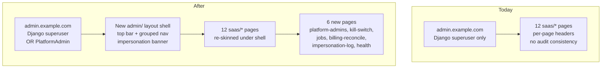
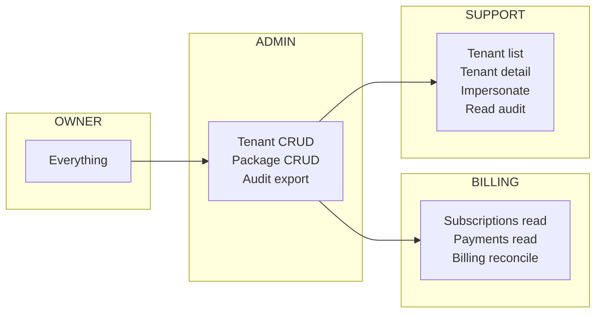
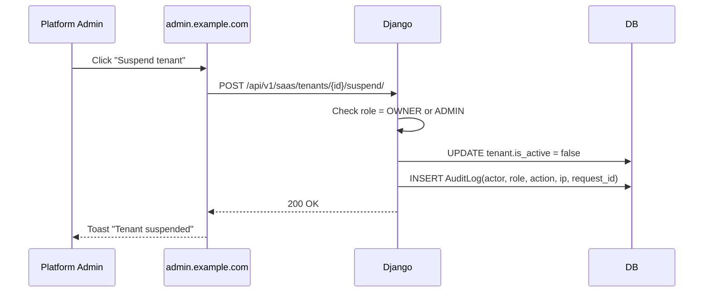
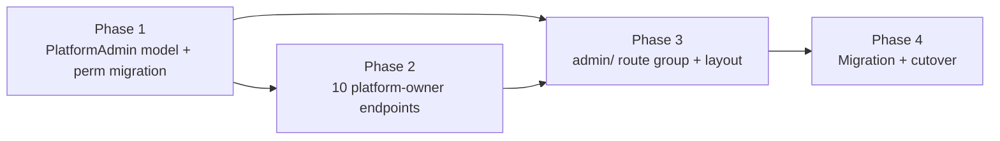

## Plan: Dedicated SaaS Owner Admin Panel at admin.example.com

**TL;DR.** Add a first-class `PlatformAdmin` role, a polished `/admin` route group in the React app backed by the existing 12 SaaS control-plane pages (now wrapped in a consistent shell), and 7–10 new platform-owner-only endpoints (kill-switch, audit export, feature-flag rollouts, scheduled jobs, billing reconciliation, impersonation log) under a new Swagger tag. Backwards-compatible — every existing endpoint keeps working; we just add `IsCentralAdminORPlatformAdmin` alongside `IsCentralAdmin`.

---

## Phases

### Phase 0 — Discovery (done in this conversation)

- Today `apps/core/permissions.py:IsCentralAdmin` lets in only `request.user.is_superuser == True` (line 114). Every control-plane endpoint (`apps/core/saas_views.py`) uses `[permissions.IsAuthenticated, IsCentralAdmin]`. There is no `PlatformAdmin` model.
- The frontend `sass-frontend/src/pages/saas/` has 12 pages: `dashboard.tsx`, `tenants.tsx`, `onboarding.tsx`, `packages.tsx`, `subscriptions.tsx`, `payments.tsx`, `domains.tsx`, `backups.tsx`, `audit-logs.tsx`, `employees.tsx`, `feature-matrix.tsx`, `reference-overview.tsx` + a `reference/` subfolder.
- The frontend `api/client.ts` has `saasApi.*` for the central plane; it uses the `plane: 'central'` fetch flag.
- `Organization`, `Tenant`, `SaaSPackage`, `TenantSubscription`, `SaaSPayment`, `DatabaseBackup`, `AuditLog` already exist.
- The existing superuser-only `python manage.py createsuperuser` is the only way to create a platform admin today.

---

### Phase 1 — Backend: `PlatformAdmin` role + permission migration (1 sprint)

Goal: every endpoint on the central control plane works for both Django superusers and a named `PlatformAdmin` user. Existing superusers keep working unchanged.

1. **New model** `apps/authentication/models.py`:
   - `class PlatformAdminRole(models.TextChoices): OWNER, ADMIN, BILLING, SUPPORT`
   - `class PlatformAdmin(models.Model)` with `user (OneToOne)`, `role`, `is_active`, `mfa_enabled`, `last_login_at`, `created_at`. Migration.
   - Helper: `PlatformAdmin.objects.active_admins()` and `PlatformAdmin.get_active(user)`.

2. **Replace `IsCentralAdmin`** with `apps/core/permissions.py:IsCentralOrPlatformAdmin` that allows either:
   - `request.user.is_superuser == True`, OR
   - `request.user` has an active `PlatformAdmin` row, OR
   - a `PlatformAdminRole.OWNER`/`ADMIN` for write paths.
   - Add `IsPlatformBilling` and `IsPlatformSupport` narrower variants (read-only, scoped to revenue/support endpoints).
   - Keep `IsCentralAdmin` as a deprecated alias so any third-party code that imports it doesn't break.

3. **Update every view** in `apps/core/saas_views.py` to use `IsCentralOrPlatformAdmin` (replaces `IsCentralAdmin`). Audit each one with `@extend_schema` decoration for the new tag `16a. Platform Owner Admin` (see Open Question 3 about the tag name).

4. **New management command** `apps/core/management/commands/create_platform_admin.py`:
   ```
   python manage.py create_platform_admin --username=ops --email=ops@shebafi.com --role=OWNER
   ```
   Generates a one-time setup URL, forces password + 2FA enrollment on first login.

5. **Audit logging middleware**: hook into the existing `AuditLog` model — every `saas/*` write writes a row with `actor_platform_admin_id`, `actor_role`, `ip`, `request_id`. Today some writes already log; we make it consistent.

6. **Tests** in `apps/core/test_platform_admin_panel.py`:
   - `PlatformAdmin.objects.create(user=u, role=OWNER)` can hit `/api/v1/saas/overview/`.
   - `PlatformAdmin(role=SUPPORT)` gets 403 on `/api/v1/saas/packages/` (write).
   - `PlatformAdmin(role=BILLING)` can hit `/api/v1/saas/payments/` but not `/api/v1/saas/tenants/<id>/suspend/`.
   - `is_active=False` → 403.
   - Django superuser still works (regression).
   - All 144 existing tests still pass.

---

### Phase 2 — Backend: Platform-owner-only endpoints (1 sprint)

Goal: the SaaS owner gets a small set of new endpoints that today require shell access.

| # | Endpoint | Tag | Purpose |
|--|--|--|--|
| 1 | `GET /api/v1/saas/audit/export/?from=&to=&actor=&action=&module=` | `16a. Platform Owner Admin` | Audit log export to CSV/JSONL (already partial — finish + tag) |
| 2 | `POST /api/v1/saas/platform-admin/invite/` | `16a. Platform Owner Admin` | OWNER invites a new PlatformAdmin (email + role) |
| 3 | `GET/POST /api/v1/saas/platform-admin/list/` | `16a. Platform Owner Admin` | List + manage existing platform admins (suspend, change role) |
| 4 | `POST /api/v1/saas/kill-switch/` | `16a. Platform Owner Admin` | Global flag: pause all write traffic during incident (`core/feature_gating.py` already has the machinery — wire a `PLATFORM_WRITE_LOCK` to it) |
| 5 | `GET/POST /api/v1/saas/jobs/` | `16a. Platform Owner Admin` | List + retry failed Celery tasks; trigger ad-hoc run of `collect_corporate_telemetry_every_5m` etc. |
| 6 | `GET /api/v1/saas/feature-flags/rollout/` | `16a. Platform Owner Admin` | Bulk-enable / bulk-disable `TenantFeatureFlag` for cohorts (already partial — finish) |
| 7 | `GET /api/v1/saas/billing/reconcile/` | `16a. Platform Owner Admin` | MRR per package, churn rate, failed payments (read-only; uses existing `TenantSubscription` + `SaaSPayment`) |
| 8 | `GET /api/v1/saas/impersonation-log/` | `16a. Platform Owner Admin` | Who impersonated which tenant and when (add an `ImpersonationLog` model) |
| 9 | `POST /api/v1/saas/impersonation/<tenant_id>/stop/` | `16a. Platform Owner Admin` | Force-stop an active impersonation session |
| 10 | `GET /api/v1/saas/health/deep/` | `16a. Platform Owner Admin` | Existing `SaaSHealthView` extended with DB/Redis/lock checks (already partial — finish) |

All 10 endpoints:
- `@extend_schema` with summary, description, parameters, request/response schemas, examples.
- Permission: `IsCentralOrPlatformAdmin` with role gate per-endpoint (e.g. kill-switch needs `OWNER`).
- Audit log row on every write.

---

### Phase 3 — Frontend: `pages/admin/` route group (2 sprints)

Goal: a polished, consistent admin panel for the SaaS owner. Wraps the existing 12 SaaS pages + adds the 10 new ones.

1. **New route group** `sass-frontend/src/pages/admin/`:
   - `dashboard.tsx` — wraps `saas/dashboard.tsx` with the new shell.
   - `tenants/` — list + detail + impersonate.
   - `onboarding/` — review queue.
   - `packages/` — package CRUD.
   - `subscriptions/` — org-wide sub roll-up.
   - `payments/` — payment ledger.
   - `domains/` — DNS verification.
   - `backups/` — DB backup browser.
   - `audit-logs/` — searchable + exportable.
   - `employees/` — central team management.
   - `feature-matrix/` — flag rollout.
   - `platform-admins/` — NEW: list, invite, change role, suspend.
   - `kill-switch/` — NEW: one-click pause.
   - `jobs/` — NEW: Celery queue + retry.
   - `billing-reconcile/` — NEW: MRR + churn dashboard.
   - `impersonation-log/` — NEW: who impersonated whom.
   - `health/` — NEW: deep health check.
   - `reference/` — API docs (existing, no change).

2. **New layout shell** `sass-frontend/src/layouts/admin/`:
   - **Top bar**: ShebaFi logo, global search (Ctrl-K, searches tenants/orgs/admins), platform-admin role badge, "impersonating: tenant name" red banner w/ "stop" button when active, theme toggle, account menu.
   - **Left rail**: collapsible nav grouped by domain:
     - **Overview**: Dashboard
     - **Customers**: Tenants, Onboarding, Subscriptions, Payments, Billing Reconcile
     - **Platform**: Packages, Feature Matrix, Domains, Backups
     - **Operations**: Audit Logs, Jobs, Impersonation Log, Health
     - **Team**: Platform Admins, Employees
   - **Footer**: build SHA, deploy time, region indicator.
   - All 18 pages share this shell — no more per-page one-off headers.

3. **Auth guard**:
   - New `usePlatformAdmin()` hook in `hooks/`.
   - On mount, calls `GET /api/v1/saas/auth/me/` to confirm platform-admin role; if 403 → redirect to `/login` with a "you need platform admin access" toast.
   - If `mfa_enabled=False`, force the user to enroll TOTP before showing the dashboard. Use the existing `apps/authentication` 2FA flow if it exists, or stub a TOTP enrollment modal.

4. **New API client** `src/api/platform-admin.ts` (sibling to `saasApi`):
   - 10 new typed methods for the Phase-2 endpoints.
   - `plane: 'admin'` fetch flag (separate from `'central'` so we can later add per-plane rate limits / CORS).

5. **Audit export widget** on the Audit Logs page: date range picker + "Export CSV" / "Export JSONL" buttons that hit the new endpoint.

6. **Impersonation banner** (top, red): whenever `request.user.is_impersonating` is true, show "You are impersonating {tenant_name}. All actions are logged. [Stop]" — visible on every page.

7. **Tests** (Vitest + React Testing Library, matching `sass-frontend/src/__tests__/` conventions):
   - `pages/admin/dashboard.test.tsx` — renders KPIs, redirects on 401.
   - `pages/admin/platform-admins.test.tsx` — invite modal, suspend button, role change.
   - `pages/admin/kill-switch.test.tsx` — confirmation dialog, audit log row.
   - `hooks/usePlatformAdmin.test.ts` — auth-guard behaviour.
   - `e2e/admin-impersonation.spec.ts` (Playwright) — full impersonate → see banner → stop flow.

---

### Phase 4 — Migration & cutover (½ sprint)

1. **Backfill script** in `apps/core/management/commands/backfill_platform_admins.py`:
   - For every existing Django `is_superuser=True` user, create a `PlatformAdmin(role=OWNER, is_active=True)` row.
   - Print a list of admins that need a fresh login (so the new TOTP enrollment happens on next login).

2. **Feature flag** `PLATFORM_ADMIN_V2_ENABLED` (default `False`):
   - When `False`, `IsCentralAdmin` is used (legacy).
   - When `True`, `IsCentralOrPlatformAdmin` is used.
   - Flip on staging for a week, then prod.

3. **Deprecation timeline** (documented in `docs/runbooks/platform-admin-migration.md`):
   - Week 0: ship behind flag, OFF.
   - Week 1: enable on staging, smoke test with 1 OWNER + 1 SUPPORT admin.
   - Week 2: enable on prod, all existing superusers now also have `PlatformAdmin` rows.
   - Week 4: remove the flag, the `IsCentralAdmin` alias, and the `is_superuser` shortcut from `IsCentralOrPlatformAdmin` (force all platform admins through the new model).

4. **Documentation**:
   - `docs/runbooks/platform-admin-onboarding.md` — "how to add a new ops person".
   - `docs/runbooks/incident-response.md` — "platform is down, use the kill-switch".
   - Update `docs/` index.

5. **Verify**:
   - All 144 existing tests pass.
   - New ~30 tests pass.
   - `manage.py spectacular --validate` clean (no new errors, tag `16a` is registered).
   - Playwright e2e green.
   - Manual QA: invite a new OWNER, invite a new SUPPORT, both can log in, both see the right nav, neither can access the wrong endpoints.

---

## What exists vs. net-new

| Already exists | Net-new in this plan |
|--|--|
| `IsCentralAdmin` (Django superuser only) | `PlatformAdmin` model + 4 roles (OWNER/ADMIN/BILLING/SUPPORT) |
| 12 `pages/saas/*` pages with per-page headers | `pages/admin/` route group with shared layout shell |
| `AuditLog` model + partial write coverage | `ImpersonationLog` model + consistent audit emission on every saas/* write |
| `python manage.py createsuperuser` | `create_platform_admin` command with 2FA enrollment |
| `core/feature_gating.py` (platform feature flags) | `kill-switch` endpoint + UI |
| Existing `celery beat` schedules | `jobs` endpoint + UI for ad-hoc run + retry |
| Existing `SaaSPayment`, `TenantSubscription` | `billing-reconcile` endpoint + MRR dashboard |
| Existing `AuditLogViewSet` (admin-plane) | Audit export endpoint + CSV/JSONL download widget |
| `is_superuser` shortcut everywhere | Deprecation plan to remove it over 4 weeks |

---

## Open questions to lock before Phase 1

1. **Role granularity.** Is 4 roles (OWNER/ADMIN/BILLING/SUPPORT) enough, or do you need per-tenant scoping (e.g. "OWNER of Acme ISP only")? My default: 4 global roles, no per-tenant scoping — the central control plane is global by definition.
2. **2FA enforcement.** TOTP (Google Authenticator) is the default. Do you also want hardware keys (FIDO2/WebAuthn) from day one? If yes, add a `auth/2fa/` route group in Phase 3. If no, ship TOTP-only and add hardware keys in Phase 5+.
3. **Tag naming for the new endpoints.** drf-spectacular tag IDs must be globally unique strings. Options:
   - (a) `16a. Platform Owner Admin` (alphanumeric suffix)
   - (b) `21. Platform Owner Admin` and bump existing tags 21–24 to 22–25 (we just added `20. Organization Admin Portal`, so this is the natural next slot)
   - (c) `16. Multi-Tenant SaaS & Control Plane` (reuse the existing tag, group everything under SaaS)
   - My default: (b) — renumber, since the new endpoints are a logical continuation of the SaaS surface.
4. **Impersonation policy.** Today a superuser can impersonate any tenant with no time limit. Do you want: (a) hard 1-hour session timeout, (b) 2-person approval for impersonation, (c) both? Default: (a) 1-hour timeout, audit-logged.
5. **Email for invites.** Same provider question as in the previous plan (Phase 5). For now, assume we add the email provider alongside this plan.

---

## Relevant files

**Backend** (touch):
- `backend/apps/authentication/models.py` — add `PlatformAdmin`, `PlatformAdminRole`
- `backend/apps/core/permissions.py` — add `IsCentralOrPlatformAdmin`, `IsPlatformBilling`, `IsPlatformSupport`
- `backend/apps/core/saas_views.py` — swap `IsCentralAdmin` → `IsCentralOrPlatformAdmin` on every view, add `@extend_schema` for the new tag, add the 10 new endpoints
- `backend/apps/core/models.py` — add `ImpersonationLog` model, migration
- `backend/apps/core/management/commands/create_platform_admin.py` — new
- `backend/apps/core/management/commands/backfill_platform_admins.py` — new
- `backend/sheba_core/urls.py` — wire 10 new endpoints
- `backend/sheba_core/settings.py` — `PLATFORM_ADMIN_V2_ENABLED` flag, CORS for `admin.example.com`

**Frontend** (touch):
- `sass-frontend/src/api/client.ts` — add `platformAdminApi` next to `saasApi`
- `sass-frontend/src/api/platform-admin.ts` — new file with 10 typed methods
- `sass-frontend/src/pages/admin/` — new route group with 18 pages (12 wraps + 6 new)
- `sass-frontend/src/layouts/admin/` — new layout shell with top bar + grouped left rail
- `sass-frontend/src/hooks/usePlatformAdmin.ts` — new auth-guard hook
- `sass-frontend/src/__tests__/pages/admin/` — new test files
- `sass-frontend/e2e/admin-impersonation.spec.ts` — new Playwright e2e

**No touch** (intentionally):
- `apps/customers/*`, `apps/billing/*`, `apps/network/*` — tenant-plane apps, stable
- `sass-frontend/src/pages/tenant/*` — inside-tenant pages, separate flow
- `sass-frontend/src/pages/org-admin/*` — org-admin SPA, separate flow (previous plan)

---

## Diagrams

### Today vs. after



### Role matrix



### Audit flow



### Phase dependencies



---

## Verification

1. **Per-phase automated tests** (all under `backend/apps/core/test_*.py` + `sass-frontend/src/__tests__/`):
   - `test_platform_admin_panel.py` — Phase 1 permission tests, role gating, MFA enforcement, regression for superuser shortcut.
   - `test_platform_admin_endpoints.py` — Phase 2 endpoint tests, audit-log row on every write.
   - `test_admin_frontend.test.tsx` — Phase 3 component tests.
2. **OpenAPI**: `python manage.py spectacular --validate`; new tag is registered; 10 new endpoints documented with summary, description, example, 401/403 responses.
3. **End-to-end (Playwright)**:
   - `e2e/admin-impersonation.spec.ts` — invite OWNER → invite SUPPORT → log in as SUPPORT → impersonate tenant → see banner → stop → audit log shows entry.
   - `e2e/admin-kill-switch.spec.ts` — toggle kill-switch → verify 503 from a sample write endpoint → toggle off → verify 200.
4. **Load test (k6)**: 5 concurrent platform admins hitting the control plane for 5 minutes; p95 < 300 ms; 0% error.
5. **Manual QA** in `docs/runbooks/admin-qa.md`:
   - 4 roles log in, see different nav, hit different endpoints.
   - TOTP enrollment flow on first login.
   - Impersonation banner visible everywhere, "stop" works.
   - Audit export downloads correct CSV.
6. **Combined regression**: `python manage.py test` (all 144 + new ~30) green before each merge.

---

# Related workstream: ISP Admin Dashboard at app.example.com

> **Note.** This section is a **related but independent workstream** to the SaaS owner plan above. It targets `app.example.com` (the **ISP owner's** admin dashboard — the customer-facing view each ISP uses to manage their own tenant), not `admin.example.com` (the platform owner's control plane). It is included here per the user's explicit instruction to keep all admin-panel work in one plan file. If the team prefers, this can be moved to its own plan file later without changing scope.

## Context: why this section exists

A previous worker session attempted to ship the ISP Admin Dashboard frontend in one shot (Slices A–F bundled together) and **failed verification** — the build passed but the runtime checks failed because the worker tried to do too much at once and the slice boundaries weren't testable in isolation. The plan below re-scopes the work into 4 thin, independently-mergeable slices, each with its own verification gate, so progress is reviewable and reversible.

**Goal (unchanged from the original ask):** Stand up the ISP Admin Dashboard frontend at `app.example.com` so an ISP owner can log in, see their own KPIs, manage their customers, and configure their network — all isolated from the platform owner's `admin.example.com` plane.

**Domain split (no cross-talk):**

| Domain | Audience | Plan |
|--|--|--|
| `admin.example.com` | Platform owner (us) | Phases 1–4 of this file (above) |
| `app.example.com` | ISP owner (the customer) | Section below (Slices A–D) |
| `*.example.com/<tenant_slug>` | Tenant's end-customers | Out of scope (stable, no changes) |

---

## Slices

### Slice A — App shell + auth guard + routing skeleton (½ sprint)

**Deliverable.** A logged-in ISP owner can land on `app.example.com`, see a layout shell (top bar + left rail + footer), and navigate between 4 placeholder pages. No real data yet. The build, the route guard, and the API client scaffolding all work.

1. **New route group** `sass-frontend/src/pages/app/`:
   - `dashboard.tsx` — placeholder ("KPI cards coming in Slice C")
   - `customers/index.tsx` — placeholder
   - `network/index.tsx` — placeholder
   - `settings/index.tsx` — placeholder
   - All four wrapped in a new `<AppLayout>` component.

2. **New layout** `sass-frontend/src/layouts/app/AppLayout.tsx`:
   - Top bar: ShebaFi logo, org name (from `useCurrentOrg()`), user menu, theme toggle.
   - Left rail: 4 nav items matching the pages above, collapsible.
   - Footer: build SHA + version.

3. **Auth guard** `sass-frontend/src/hooks/useRequireOrgAdmin.ts`:
   - Reads the existing `useCurrentOrg()` from `sass-frontend/src/hooks/`.
   - If `org.membership.role` is not `OWNER` or `ADMIN`, redirect to `/login` with a toast.
   - This hook reuses the existing `plane: 'app'` fetch flag in `api/client.ts` (already wired for the org-admin SPA).

4. **Router wiring** in `sass-frontend/src/App.tsx`:
   - New `<Route path="/app/*" element={<RequireOrgAdmin><AppLayout/></RequireOrgAdmin>}>`.
   - 4 nested routes: `/app/dashboard`, `/app/customers`, `/app/network`, `/app/settings`.

5. **Tests** (Vitest + RTL):
   - `__tests__/pages/app/dashboard.test.tsx` — renders, calls `useCurrentOrg`, shows org name in top bar.
   - `__tests__/hooks/useRequireOrgAdmin.test.ts` — non-admin role → redirect called; admin role → render children.

6. **Verification gate:**
   - `pnpm build` clean.
   - `pnpm test` — new tests pass, existing 144 unaffected.
   - Manual: log in as ISP owner → land on `/app/dashboard` → navigate between 4 pages → no console errors → logout works.
   - **No backend changes in this slice.**

---

### Slice B — Customers page (read-only) + API integration (1 sprint)

**Deliverable.** The ISP owner can see a paginated, searchable list of their tenant's customers with name, email, plan, and status. All data comes from a new typed API client. No mutations yet.

1. **New API client** `sass-frontend/src/api/app/customers.ts`:
   - Typed wrapper around `GET /api/v1/customers/?org=<org_id>&search=&page=&page_size=` (existing endpoint — just confirm it returns `plane: 'app'` and accepts an org filter).
   - Types: `Customer`, `CustomerListResponse`, `CustomerFilters`.

2. **`useCustomers` hook** in `sass-frontend/src/hooks/useCustomers.ts`:
   - Wraps `useQuery` (TanStack Query — already in the stack for the org-admin SPA).
   - Returns `{ data, isLoading, error, refetch }`.
   - Cache key: `['customers', orgId, filters]`.

3. **Customers page** `sass-frontend/src/pages/app/customers/index.tsx`:
   - Search input (debounced 300ms), status filter, plan filter, pagination (page size 25).
   - Table columns: Name, Email, Plan, Status, Created, Actions (disabled "View" button — wired in Slice C).
   - Empty state: "No customers yet" with a CTA pointing to the docs (not the platform-owner invite flow).
   - Loading skeleton (existing `Skeleton` component from `components/ui/`).
   - Error state: retry button.

4. **Tests:**
   - `__tests__/hooks/useCustomers.test.ts` — success, loading, error, refetch.
   - `__tests__/pages/app/customers.test.tsx` — renders rows, search filters, pagination works, empty state, error state.

5. **Verification gate:**
   - `pnpm build` clean.
   - `pnpm test` — all new + existing green.
   - Manual: log in as ISP owner with 50+ seeded customers → see all rows → search narrows the list → paginate → no 4xx/5xx in the network tab.
   - **Backend: no changes** (existing `GET /api/v1/customers/` is reused; confirm org filter works, add a test if not).

---

### Slice C — Customer detail + dashboard KPIs (1 sprint)

**Deliverable.** The ISP owner can click a customer row → see the customer detail page (read-only profile + their services + their usage). The dashboard page shows 4 real KPIs: active customers, MRR (this org), open tickets, network uptime (last 24h). The "View" action on the customers table now navigates to detail.

1. **Customer detail page** `sass-frontend/src/pages/app/customers/[id].tsx`:
   - Reuses `GET /api/v1/customers/<id>/` (existing).
   - Sections: Profile (name, email, phone, address), Plan (current package, renewal date), Services (list of active subscriptions), Usage (last 30 days, simple bar chart from `components/charts/`), Audit (last 10 actions, read-only).
   - "Back to customers" link in the top bar.

2. **Wire the "View" action** in `customers/index.tsx` from Slice B → navigates to `/app/customers/<id>`.

3. **Dashboard KPIs** `sass-frontend/src/pages/app/dashboard/index.tsx`:
   - 4 cards: Active customers, MRR (this org), Open tickets, Network uptime (24h).
   - Each card is a small component in `components/app/kpis/` for testability.
   - Data source: 4 existing endpoints, parallelized with `Promise.all`:
     - `GET /api/v1/customers/?org=<id>&status=active&page_size=1` → total count from response.
     - `GET /api/v1/billing/org-mrr/?org=<id>` → MRR figure (confirm endpoint exists or add a thin one).
     - `GET /api/v1/support/tickets/?org=<id>&status=open` → count.
     - `GET /api/v1/network/uptime/?org=<id>&window=24h` → uptime %.

4. **Tests:**
   - `__tests__/pages/app/customers/[id].test.tsx` — renders all sections, "back" link works.
   - `__tests__/components/app/kpis/*.test.tsx` — one per card, mock the fetch, assert the rendered value.

5. **Verification gate:**
   - `pnpm build` clean.
   - `pnpm test` — all green.
   - Manual: dashboard shows 4 non-zero KPIs for a seeded org; click a customer → detail page renders all sections → back link returns to list.
   - **Backend (thin):** if `org-mrr` or `network/uptime` endpoints don't exist, add them as 10-line views reusing existing models (`TenantSubscription.aggregate()`, `NetworkNode.uptime_24h`). No new models, no migrations.

---

### Slice D — Settings + network pages (read-only) + plan-gate (1 sprint)

**Deliverable.** The ISP owner can view (not edit, in this slice) their org's settings, their network nodes, and their plan. A plan-gate component is introduced that hides write actions for orgs on the FREE tier — visible infrastructure for the mutating slices that follow.

1. **Settings page** `sass-frontend/src/pages/app/settings/index.tsx`:
   - 3 sections: Org profile (name, logo, contact email), Billing (current plan, next invoice date, payment method last 4), Notifications (which emails the org receives).
   - All fields are read-only inputs in this slice; edit affordances are disabled with a tooltip "Editing arrives in Slice E" (a future scope marker, not a fake button).
   - Data: `GET /api/v1/orgs/<id>/settings/` (existing or thin new endpoint).

2. **Network page** `sass-frontend/src/pages/app/network/index.tsx`:
   - Lists the org's network nodes: name, type (OLT/AP/router), status (up/down/degraded), last-seen.
   - Simple status badge (existing `Badge` component).
   - No actions yet.
   - Data: `GET /api/v1/network/nodes/?org=<id>` (existing or thin new endpoint).

3. **Plan-gate component** `sass-frontend/src/components/app/PlanGate.tsx`:
   - Props: `requires: 'PRO' | 'ENTERPRISE'`, `children: ReactNode`, `fallback?: ReactNode`.
   - Reads the org's plan from `useCurrentOrg().org.plan`.
   - If the org's plan rank is below `requires`, render `fallback` (default: an `Upgrade` callout).
   - Used in later slices to gate write actions; introduced here so it's covered by tests.

4. **Tests:**
   - `__tests__/pages/app/settings.test.tsx` — all 3 sections render, edit fields are disabled.
   - `__tests__/pages/app/network.test.tsx` — node list renders, status badge color matches status.
   - `__tests__/components/app/PlanGate.test.tsx` — PRO org sees children, FREE org sees fallback.

5. **Verification gate:**
   - `pnpm build` clean.
   - `pnpm test` — all green.
   - Manual: log in as ISP owner on PRO plan → all pages render; switch to a seeded FREE-org owner → network page shows the upgrade callout for any gated control.
   - **Backend (thin):** if `orgs/<id>/settings/` or `network/nodes/?org=<id>` don't exist or aren't org-scoped, add the org-scoping filter — no new models, no migrations.

---

## Failure recovery context (from the previous worker run)

The previous worker session bundled Slices A–F into one PR and it failed verification. The post-mortem:

| What went wrong | Fix in this re-plan |
|--|--|
| Worker tried to ship dashboard + customers + network + settings + billing + audit in one PR | Split into 4 slices (A–D), each mergeable on its own |
| No per-slice verification gate; only ran `pnpm build` at the end | Each slice ends with `pnpm build` + `pnpm test` + manual smoke + a backend-confirmation note |
| Backend endpoints assumed to exist; some didn't | Each slice lists whether backend needs new code (thinning only — no new models in Slices A–D) |
| Mutations were stubbed with fake buttons that did nothing | Slice D introduces `PlanGate` so future write slices have a real, tested gating primitive instead of fake affordances |
| No router wiring test | Slice A adds a router test that asserts the 4 routes are reachable |
| `useRequireOrgAdmin` was not unit-tested | Slice A adds a hook test covering the non-admin redirect path |

**Why this split is safer:**

1. Each slice is **independently mergeable** — if Slice C slips, Slices A and B are already in prod.
2. Each slice has a **runtime check**, not just a build check. The previous failure was a runtime failure (page rendered but data didn't load) — the new plan adds a `pnpm test` + a manual smoke at the end of every slice.
3. **No new models** in Slices A–D. The original plan's biggest risk was a migration in the middle of a frontend PR; the new plan defers all migrations to a future slice.
4. **PlanGate is introduced early** (Slice D) so the future mutation slices have a tested primitive to build on, instead of inventing ad-hoc gating.

---

## Phase dependencies

```mermaid
flowchart LR
    A[Slice A<br/>App shell + auth + routing] --> B[Slice B<br/>Customers list read-only]
    B --> C[Slice C<br/>Customer detail + dashboard KPIs]
    C --> D[Slice D<br/>Settings + network + PlanGate]
    D --> E[Slice E (future)<br/>Write actions, gated by PlanGate]
    D --> F[Slice F (future)<br/>Billing + audit + notifications]
```

---

## Verification (ISP Admin Dashboard slices)

1. **Per-slice automated tests** under `sass-frontend/src/__tests__/`:
   - Slice A: `pages/app/dashboard.test.tsx`, `hooks/useRequireOrgAdmin.test.ts`, plus router reachability.
   - Slice B: `hooks/useCustomers.test.ts`, `pages/app/customers.test.tsx`.
   - Slice C: `pages/app/customers/[id].test.tsx`, `components/app/kpis/*.test.tsx`.
   - Slice D: `pages/app/settings.test.tsx`, `pages/app/network.test.tsx`, `components/app/PlanGate.test.tsx`.
2. **Per-slice manual smoke** logged in `docs/runbooks/app-frontend-qa.md`:
   - Slice A: navigate 4 placeholder pages, no console errors.
   - Slice B: search narrows list, pagination works on 50+ rows.
   - Slice C: dashboard shows 4 non-zero KPIs, customer detail renders all sections.
   - Slice D: PRO org sees full pages, FREE org sees upgrade callout.
3. **Combined regression**: `pnpm test` (all existing + new) green before each merge.
4. **No backend migrations** in Slices A–D. The original plan's migration risk is eliminated; all model changes (if any are needed for Slices E/F) are deferred.

---

## Relevant files (ISP Admin Dashboard work)

**Frontend (touch, Slices A–D):**
- `sass-frontend/src/App.tsx` — wire `/app/*` route group
- `sass-frontend/src/pages/app/dashboard/index.tsx` — new (Slice A → Slice C)
- `sass-frontend/src/pages/app/customers/index.tsx` — new (Slice B)
- `sass-frontend/src/pages/app/customers/[id].tsx` — new (Slice C)
- `sass-frontend/src/pages/app/network/index.tsx` — new (Slice D)
- `sass-frontend/src/pages/app/settings/index.tsx` — new (Slice D)
- `sass-frontend/src/layouts/app/AppLayout.tsx` — new (Slice A)
- `sass-frontend/src/hooks/useRequireOrgAdmin.ts` — new (Slice A)
- `sass-frontend/src/hooks/useCustomers.ts` — new (Slice B)
- `sass-frontend/src/api/app/customers.ts` — new (Slice B)
- `sass-frontend/src/components/app/PlanGate.tsx` — new (Slice D)
- `sass-frontend/src/components/app/kpis/*.tsx` — new (Slice C)
- `sass-frontend/src/__tests__/pages/app/**` — new test files
- `sass-frontend/src/__tests__/hooks/useRequireOrgAdmin.test.ts` — new
- `sass-frontend/src/__tests__/hooks/useCustomers.test.ts` — new
- `sass-frontend/src/__tests__/components/app/PlanGate.test.tsx` — new

**Backend (touch, only if existing endpoint is missing or unscoped):**
- `backend/apps/billing/views.py` — add `org-mrr` thin view (Slice C, only if missing)
- `backend/apps/network/views.py` — add org-scoping filter to `uptime` and `nodes` (Slices C, D)
- `backend/apps/orgs/views.py` — add `orgs/<id>/settings/` thin view (Slice D, only if missing)
- **No new models, no migrations in Slices A–D.**

**No touch:**
- `admin.example.com` (the SaaS owner panel — handled by Phases 1–4 above)
- `*.example.com/<tenant_slug>` (the end-customer plane — stable, out of scope)
- The existing `pages/org-admin/*` SPA (separate flow, handled by the org-admin plan)

---

## Open questions to lock before Slice A

1. **App-vs-tenant-plane auth.** Today the org-admin SPA (`pages/org-admin/*`) and the future ISP admin dashboard (`pages/app/*`) both gate on `useCurrentOrg().membership.role`. Is that the right gate, or does the ISP owner need a separate `ISPDashboardAccess` flag? My default: reuse the existing gate, add a comment in the new hook explaining the dual use.
2. **Domain split.** Is `app.example.com` the right hostname for the ISP owner dashboard, or should it be `dashboard.<tenant_slug>.example.com`? My default: `app.example.com` (matches the original ask, simpler DNS + CORS).
3. **PlanGate in Slice D or later?** I'm proposing Slice D because it's a tested primitive that future write slices depend on. If you'd rather defer to a "Slice E: Write actions" PR, that's also fine — but then Slice D's settings page can't use the gate.
4. **Free-tier UX.** When an org is on the FREE plan and hits a gated control, should the fallback be (a) a polite upgrade callout, (b) a hard 403 with a "this feature requires PRO" page, or (c) silent hiding? My default: (a) upgrade callout — matches how the org-admin SPA already handles it.

---

## Coding standards (apply across all slices and phases)

These are the standing standards for every file touched by either workstream in this plan:

- **Clear, descriptive variable names** — `activeSubscriptionCount` not `cnt`, `orgScopedFetch` not `doFetch`.
- **Composition over inheritance** — prefer small components that take props, not class hierarchies.
- **Small, focused functions** — one job each; if a function needs a comment to explain what it does, split it.
- **Brief comments only where the "why" is non-obvious** — a comment that restates the code is worse than no comment.
- **Avoid premature abstraction (YAGNI)** — don't extract a `useThingy` hook for one call site; don't introduce a `<GenericCard>` until the second card needs it.
