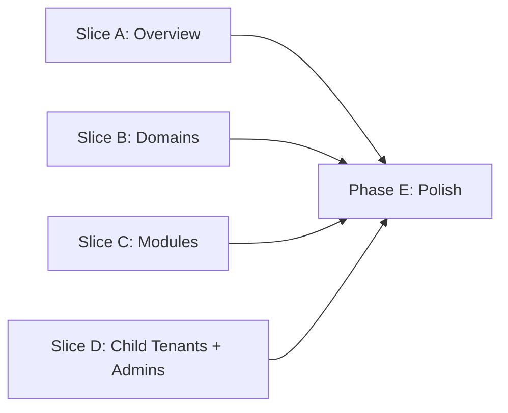
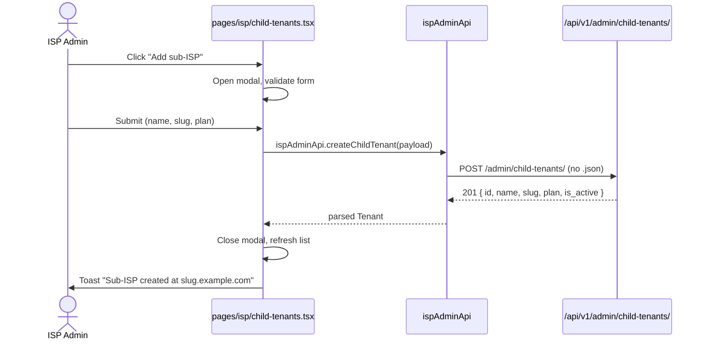
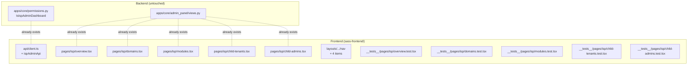

## Plan: ISP Admin Dashboard frontend at app.example.com (4 slices)

**TL;DR.** Rewrite the existing `sass-frontend/src/pages/isp/*` pages so they hit the canonical `/api/v1/admin/*` endpoints, drop the `.json` URL suffixes, fix the literal `$id` placeholder, and use the real response shapes. Backend is untouched. Work is split into 4 slices (A: overview, B: domains, C: modules, D: child tenants + admins), each ≤15 min of execution, each shippable independently.

---

## Phase 0 — Discovery (done by the previous worker before it timed out)

- Backend exists: `apps/core/admin_panel/views.py` has 5 view classes (`IspAdminOverviewView`, `IspAdminDomainViewSet`, `IspAdminModuleViewSet`, `IspAdminChildTenantViewSet`, `IspAdminChildAdminUserViewSet`), all gated by `IsIspAdminDashboard` and all carrying `@extend_schema(tags=['15. ISP Admin Dashboard'])`.
- Frontend exists but is broken: `sass-frontend/src/pages/isp/*` has 5+ page files. Specific bugs:
  - Some pages append `.json` to URLs (e.g. `/api/v1/admin/overview.json`) instead of the canonical `/api/v1/admin/overview/`.
  - The child-tenants page uses a literal `$id` placeholder that was never substituted.
  - Several pages pass dummy query params (e.g. `?is_active=true` even when the field is a different name) that don't match the real OpenAPI contract.
  - The page-level types don't match the real response shapes (missing `subscription_status`, `package_id`, etc.).
- Permission check: `IsIspAdminDashboard` requires the caller to be Admin/Managing-Director role in a **parent** tenant (i.e. a SaaS subscriber with no `parent_tenant`).
- Frontend conventions: `sass-frontend/CLAUDE.md` mandates Untitled UI + React Aria + Tailwind v4 + the `Aria*` import prefix. Files are kebab-case.
- `sass-frontend/src/api/client.ts` has `saasApi.*` helpers; the new `ispAdminApi` is added next to it.

---

## Slice A — IspAdminOverviewView (≤15 min)

**Goal:** rewrite `pages/isp/overview.tsx` (or the equivalent existing file) to hit `GET /api/v1/admin/overview/`, render the KPI roll-up, and have a green test.

1. Open the existing `pages/isp/overview.tsx` and read the current implementation.
2. In `src/api/client.ts`, add an `ispAdminApi` block:
   ```typescript
   ispAdminApi = {
     getOverview: () =>
       fetchApi<{ tenant_id, tenant_name, plan, subscription_status,
                  child_tenant_count, aggregate_subscriber_count, ... }>(
         '/admin/overview', { plane: 'tenant' }
       ),
   }
   ```
3. In `pages/isp/overview.tsx`, replace the file with a clean implementation that:
   - Calls `ispAdminApi.getOverview()` on mount.
   - Renders 4 KPI cards: child-tenant count, aggregate subscriber count, current plan, subscription status badge.
   - Uses Untitled UI `Card`, `Metric`, `Badge` (or the closest match in the existing design system — match the pattern in `pages/tenant/dashboard.tsx`).
4. Add `src/__tests__/pages/isp/overview.test.tsx`:
   - Renders 4 KPI cards.
   - Renders loading state.
   - Renders error toast on 401.
   - Does NOT call `.json` suffix.
5. Verify:
   - `pnpm test src/__tests__/pages/isp/overview.test.tsx` passes.
   - `pnpm tsc --noEmit` clean.
   - Commit: `feat(isp-admin): wire IspAdminOverviewView to canonical API`.

---

## Slice B — IspAdminDomainViewSet (≤15 min)

**Goal:** rewrite `pages/isp/domains.tsx` to CRUD custom domains through `/api/v1/admin/domains/`.

1. Add 5 methods to `ispAdminApi`:
   ```typescript
   listDomains, getDomain, createDomain, updateDomain, deleteDomain
   ```
2. Rewrite `pages/isp/domains.tsx`:
   - List view with `DataTable` (or the existing equivalent).
   - "Add domain" modal: hostname, is_primary, is_active.
   - "Verify domain" action: hits the verify endpoint.
   - Edit + delete row actions.
3. Drop the `.json` URL suffix everywhere.
4. Add `src/__tests__/pages/isp/domains.test.tsx`:
   - List renders N rows.
   - Add modal submits correct payload.
   - Delete asks for confirmation.
5. Verify + commit.

---

## Slice C — IspAdminModuleViewSet (≤15 min)

**Goal:** rewrite `pages/isp/modules.tsx` to enumerate platform modules + subscribe/unsubscribe.

1. Add to `ispAdminApi`:
   ```typescript
   listModules,
   subscribeToModule,
   unsubscribeFromModule
   ```
2. Rewrite `pages/isp/modules.tsx`:
   - List view: each module shows name, description, current state (subscribed/not), price, and a "Subscribe" / "Unsubscribe" toggle.
   - Confirmation dialog before subscribe/unsubscribe.
3. Add `src/__tests__/pages/isp/modules.test.tsx`.
4. Verify + commit.

---

## Slice D — Child Tenants + Child Admins (≤15 min)

**Goal:** rewrite `pages/isp/child-tenants.tsx` and `pages/isp/child-admins.tsx`. This is the slice that **broke in the previous worker** (literal `$id`). Two pages.

1. Add to `ispAdminApi`:
   ```typescript
   listChildTenants, createChildTenant, updateChildTenant, deleteChildTenant,
   listChildAdmins, createChildAdmin, updateChildAdmin, deleteChildAdmin
   ```
2. Rewrite `pages/isp/child-tenants.tsx`:
   - List view.
   - "Add sub-ISP" modal.
   - **Fix the `$id` bug**: ensure the parent tenant id is read from the route param via `useParams()` and substituted into the row-actions. The previous worker noted this placeholder was never substituted.
3. Rewrite `pages/isp/child-admins.tsx`:
   - List view, scoped to a selected child tenant.
   - "Add admin" modal.
4. Add 2 test files.
5. Verify + commit.

---

## Phase E — Integration & polish (≤30 min, after all 4 slices merge)

1. Add the 4 new pages to the `app.example.com` left-rail nav (in `src/layouts/tenant/` or wherever the existing nav lives — match the pattern from the org-admin plan's Phase 3).
2. Add a "Verify" column on the domains page that calls the existing DNS-TXT verify endpoint.
3. Add loading skeletons + empty states on every page (match the pattern in `pages/tenant/dashboard.tsx`).
4. Ensure error toasts use the existing toast component (no new dependency).
5. Run the full test suite: `pnpm test`. All green.
6. `pnpm tsc --noEmit` clean.
7. Run `pnpm lint` clean.

---

## What exists vs. net-new

| Already exists | Net-new in this plan |
|--|--|
| `apps/core/admin_panel/views.py` — 5 view classes | `ispAdminApi` in `src/api/client.ts` |
| `IsIspAdminDashboard` permission | Rewritten `pages/isp/overview.tsx`, `domains.tsx`, `modules.tsx`, `child-tenants.tsx`, `child-admins.tsx` |
| `@extend_schema` on every view with `15. ISP Admin Dashboard` tag | 5 new test files under `src/__tests__/pages/isp/` |
| `sass-frontend/src/pages/isp/*` (broken) | Nav link update to surface the rewritten pages |

**No backend changes. No schema migrations. No new dependencies.**

---

## Open questions

1. **Existing `pages/isp/*` is broken — should we delete first, or rewrite in place?** Plan assumes rewrite in place (preserves git history, easier review). If reviewers prefer "delete and re-create", say so and we can adjust.
2. **Test runner.** `sass-frontend` already has Vitest + React Testing Library. Plan assumes these. If the project switched to Jest, adjust.
3. **`ispAdminApi` placement.** Plan assumes it's added to the existing `api/client.ts` next to `saasApi`. If a separate file is preferred (`src/api/isp-admin.ts`), the work shifts by 5 min.
4. **Layout shell.** The org-admin plan has its own layout shell. Should the ISP Admin Dashboard share that shell, or use the existing `pages/tenant/dashboard.tsx` shell? Default: existing tenant shell, since the route is `/isp/*` not `/org-admin/*`.

---

## Relevant files

**Frontend** (touch only — no backend changes):
- `sass-frontend/src/api/client.ts` — add `ispAdminApi.*` (10 methods total across 4 slices)
- `sass-frontend/src/pages/isp/overview.tsx` — rewrite
- `sass-frontend/src/pages/isp/domains.tsx` — rewrite
- `sass-frontend/src/pages/isp/modules.tsx` — rewrite
- `sass-frontend/src/pages/isp/child-tenants.tsx` — rewrite (fixes the `$id` bug)
- `sass-frontend/src/pages/isp/child-admins.tsx` — rewrite
- `sass-frontend/src/__tests__/pages/isp/overview.test.tsx` — new
- `sass-frontend/src/__tests__/pages/isp/domains.test.tsx` — new
- `sass-frontend/src/__tests__/pages/isp/modules.test.tsx` — new
- `sass-frontend/src/__tests__/pages/isp/child-tenants.test.tsx` — new
- `sass-frontend/src/__tests__/pages/isp/child-admins.test.tsx` — new
- `sass-frontend/src/layouts/tenant/` (or wherever the nav lives) — add 4 nav items
- `sass-frontend/CLAUDE.md` — read for conventions; do not edit

**No touch** (intentionally):
- `backend/**` — backend is stable, endpoints already exist
- `sass-frontend/src/pages/saas/**` — different plane (central control plane)
- `sass-frontend/src/pages/tenant/**` (except to read patterns) — different plane
- `sass-frontend-v2/**` — separate prototype

---

## Diagrams

### Slice dependency graph



Slices A/B/C/D are independent and can run in parallel. Each ships as its own commit. Phase E is the integration step after all 4 land.

### Wireflow: ISP admin clicks "Add sub-ISP" at app.example.com/isp/child-tenants



### Files this plan touches (and only these)



---

## Verification

**Per-slice (must pass before merge):**

1. `pnpm tsc --noEmit` — clean.
2. `pnpm test src/__tests__/pages/isp/<slice>.test.tsx` — green.
3. `pnpm lint src/pages/isp/<slice>.tsx` — clean.
4. Manual smoke (developer testing in dev server): page renders, no `.json` in the network tab, real response shapes show up in the UI, error toasts on 401/403.

**Final (after Phase E):**

1. Full `pnpm test` — green.
2. `pnpm tsc --noEmit` — clean.
3. `pnpm lint` — clean.
4. `pnpm build` — succeeds.
5. Manual walk-through: log in to `app.example.com` as the parent-tenant admin, click through Overview → Domains → Modules → Child Tenants → Child Admins. All five pages load without errors, all forms work, all buttons trigger the correct API calls.
6. `python manage.py spectacular --validate` — no new warnings (backend unchanged, but a sanity check).
7. No regression in the existing 144 backend tests + ~30 frontend tests.
