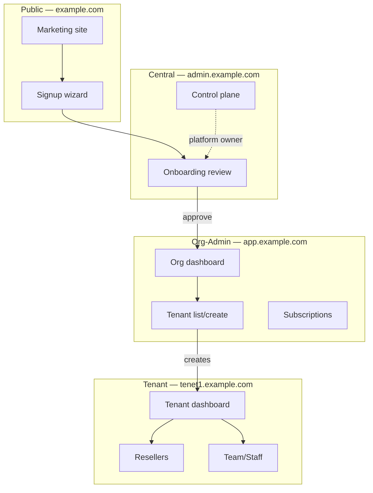
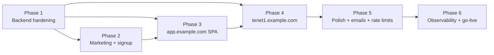

## Plan: Org-Admin Portal at app.example.com

**TL;DR.** Add a public marketing + signup site at `example.com`, a new `app.example.com` org-admin SPA backed by the existing `Organization` model, and a `tenet1.example.com` tenant-context entry that reuses the existing inside-tenant app with two new screens (resellers, staff). The whole build is split into 6 phases that ship independently; backend changes go in first, then public site, then org-admin SPA, then tenant-context.

---

## Phases

### Phase 0 — Discovery (already done in this conversation)

- The Organization/Tenant/SaaSPackage data model already exists. The `/api/v1/organizations/<id>/dashboard/`, `/tenants/`, `/tenants/<tid>/`, `/tenants/<tid>/suspend|activate/`, `/subscriptions/`, and `/saas/packages/public/` endpoints already exist (Stage 2.5 build).
- The `sass-frontend` React app already has: `pages/onboarding/wizard.tsx`, `pages/saas/*` (central control plane), `pages/tenant/dashboard.tsx`, `lib/tenant-bootstrap`, and a `api/client.ts` with `saasApi.*` and `tenantApi.*` helpers.
- The `Reseller` model (apps/customers) and `StaffMembership` model (apps/authentication) already exist.
- `DatabaseBackup` model exists with `manual` + Celery `create_backup` triggers; needs a per-tenant schedule + restore endpoint.

---

### Phase 1 — Backend hardening (1 sprint)

Goal: every screen in the org-admin SPA has a stable, well-documented API. No frontend work happens until this is done.

1. **Promote onboarding to "moderate"** (assumed).
   - Add a `signup` POST endpoint at `/api/v1/public/signup/` (no auth) that creates `TenantOnboardingRequest` + uploads a `trade-license` and `national-id` file. Move the file storage to S3/MinIO (`core/storage.py` already exists).
   - Add a `/api/v1/public/signup/<id>/status/` for the applicant to poll. WebSockets are out of scope — polling every 5 s is fine.
   - Wire the existing `SaaSOnboardingView` (central) to **approve** a request: it auto-creates the `Organization`, the owner `User`, the `OrganizationMembership` (role=OWNER), and issues a one-time claim token. The claim token is emailed to the applicant.
   - Add `@extend_schema` decorators to all 4 new public endpoints, tag them `21. Public Signup & Onboarding`.

2. **Add per-tenant staff + reseller management** under the tenant scope (not org scope).
   - `GET /api/v1/staff/` — already exists. Verify it works behind a tenant admin login.
   - `POST /api/v1/staff/invite/` — new. Sends an email invite; the invitee lands on `tenet1.example.com/accept-invite/<token>` and sets a password.
   - `GET /api/v1/resellers/`, `POST /api/v1/resellers/`, `PATCH /api/v1/resellers/<id>/` — check these exist (they do) and add `@extend_schema` to them.
   - `GET /api/v1/resellers/<id>/customers/` — sub-resource for the reseller's downstream customer list.

3. **Per-tenant database & backup surface.**
   - Add a `BackupSchedule` model (tenant, frequency: hourly/daily/weekly, retention_days, last_run_at, is_active). Migration.
   - Add `POST /api/v1/backups/schedule/` to create/update the schedule.
   - Add `POST /api/v1/backups/<id>/restore/` that creates a new `Tenant` from the dump (cloned tenant, fresh slug, owner keeps admin rights).
   - Add `GET /api/v1/backups/?type=database` filter and `GET /api/v1/backups/<id>/download/` with a short-lived signed URL.
   - Add `@extend_schema` + tag `4. Network & Core Routers` → actually `5. Tenant Backups & Restores`. Add a new tag.

4. **Lock down subdomain routing.**
   - The existing `TenantResolutionMiddleware` already routes `*.example.com` to the right `Tenant`. Add a routing rule so `app.example.com` always resolves to the **OrgAdminContext** (not a tenant), and `tenet1.example.com` resolves to the `Tenant` row with slug `tenet1`.

5. **Tests** (one file per phase).
   - `apps/core/test_signup_public.py` — covers the full signup → approval → claim flow.
   - `apps/core/test_org_admin_portal.py` — extends the existing `test_organization_stage2_5.py` with staff/reseller/backup tests.
   - All tests must pass under `manage.py test`.

---

### Phase 2 — Public marketing + signup site at `example.com` (1 sprint)

Goal: a stranger can land on `example.com`, see pricing, and complete signup with documents. After approval, they can log in at `app.example.com`.

1. **New app**: create `frontend/sites/marketing/` (a Vite + React app, same Untitled UI + React Aria + Tailwind v4 stack as `sass-frontend`).
   - Pages: `/`, `/pricing`, `/features`, `/about`, `/contact`, `/legal/privacy`, `/legal/terms`, `/login`, `/signup`.
   - Pricing page hits `GET /api/v1/saas/packages/public/` to render the cards.
   - Login page posts to `POST /api/v1/saas/auth/login/` (already exists) and redirects to `app.example.com`.
   - Signup wizard (3 steps): (a) company info, (b) primary contact, (c) KYC uploads (trade license, NID) → POSTs to `/api/v1/public/signup/`. After submit, lands on a "we'll email you" page with a polling status widget.

2. **DNS / hosting**: configure the marketing site as a separate Vercel project. The backend serves the API at `api.example.com` (or `example.com/api/v1/`, already configured via CORS in `settings.py`).

3. **CORS**: extend `CORS_ALLOWED_ORIGINS` in `settings.py` to include `https://example.com`, `https://app.example.com`, and the local dev hosts.

4. **Verify**: a new visitor can sign up, get the "pending review" page, and an admin can approve them from the existing `pages/saas/onboarding.tsx`.

---

### Phase 3 — `app.example.com` org-admin SPA (2 sprints)

Goal: a freshly approved org owner logs in at `app.example.com`, sees the org dashboard, picks a package, creates their first tenant, and is redirected to `tenet1.example.com`.

1. **New route group** in `sass-frontend/src/pages/org-admin/` (sibling to `pages/saas/` and `pages/tenant/`).
   - Auth guard: requires a valid session token AND an active `OrganizationMembership`. The org id is resolved from the session.
   - Pages:
     - `overview.tsx` — calls `GET /api/v1/organizations/me/` to find the org, then `GET /api/v1/organizations/<id>/dashboard/` for KPIs.
     - `tenants.tsx` — list + create. Create modal calls `GET /api/v1/saas/packages/public/` for the package picker, then `POST /api/v1/organizations/<id>/tenants/` with the full payload (the endpoint already returns the new admin token + tenant id + slug).
     - `tenants/<tid>.tsx` — detail page (subscription, primary domain, recent admins, suspend/activate).
     - `tenants/<tid>/domains.tsx` — manage custom domains (call existing `/tenant-domains/`).
     - `tenants/<tid>/backups.tsx` — backup list + schedule + restore.
     - `tenants/<tid>/staff.tsx` — invite/remove staff (calls the new Phase-1 endpoints).
     - `tenants/<tid>/resellers.tsx` — list/create resellers.
     - `subscriptions.tsx` — org-wide subscription roll-up.
     - `billing.tsx` — package upgrade/downgrade, payment history.
     - `settings.tsx` — org profile, members, transfer ownership.

2. **New API client** in `src/api/org-admin.ts` (sibling to `saasApi` and `tenantApi`). `plane: 'org-admin'` so the fetch wrapper hits `app.example.com/api/v1/organizations/<id>/...`.

3. **Org-admin layout shell** (`src/layouts/org-admin/`): a left rail with the org name + member list of tenants (driven by the dashboard's `recent_tenants`), a top bar with the caller's role and a "switch to tenant" dropdown.

4. **Critical UX flow** — "create your first tenant":
   - User clicks "New Tenant" → modal asks for name, slug, package.
   - On submit, hit `POST /api/v1/organizations/<id>/tenants/`. The response includes `admin.token` and `admin.username` — show these in a "save these credentials" modal with copy buttons.
   - After the user clicks "I saved them", show a "your tenant is live at `https://<slug>.example.com`" success card with a button to log into it.

5. **Verify**: an end-to-end test using Playwright (already in `sass-frontend-v2/e2e/`, can be lifted) that creates an org, picks a package, provisions a tenant, switches to the tenant subdomain, and lands on its dashboard.

---

### Phase 4 — `tenet1.example.com` tenant app entry (1 sprint)

Goal: a user logs into the tenant via the existing inside-tenant auth, and the new "Resellers" + "Staff" screens show up in the sidebar.

1. **Update the tenant layout** (`sass-frontend/src/layouts/tenant/`) to include two new sidebar items: **Resellers** and **Team**. The existing customer/staff/subscription views stay.

2. **Resellers page** (`pages/tenant/resellers.tsx`):
   - List view calling `GET /api/v1/resellers/`.
   - "Add reseller" modal calling `POST /api/v1/resellers/`. Captures `business_name`, `contact_phone`, `contact_email`, `address`, `commission_rate`.
   - Row action: view customers, edit, deactivate.

3. **Team page** (`pages/tenant/team.tsx`):
   - List view calling `GET /api/v1/staff/`.
   - "Invite staff" modal calling `POST /api/v1/staff/invite/`. Email + role + scope (TENANT / POP / SELF).
   - Row actions: edit role, deactivate, resend invite.

4. **Accept-invite page** (`pages/tenant/accept-invite.tsx`):
   - Public-ish route (no session) that takes a token from the URL.
   - On load, calls `GET /api/v1/staff/invite/<token>/` to validate.
   - Form for first name, last name, password. Posts to `POST /api/v1/staff/invite/<token>/accept/`.
   - On success, redirects to `/login`.

5. **Verify**: a tenant admin invites a staff member, the invitee receives an email, lands on the accept page, sets a password, logs in, and appears in the team list.

---

### Phase 5 — Cross-cutting polish (1 sprint)

1. **Email templates** in `core/email/`:
   - `signup_approved.html` + `txt` — "Your ShebaFi ISP Portal is ready — claim your account" with the one-time link.
   - `staff_invite.html` + `txt` — "{inviter} invited you to manage {tenant name}".
   - `backup_failed.html` + `txt` — "Your scheduled backup failed — here's the error".
   - Wire all of them through the existing `core/email/` renderer so styling matches.

2. **Subdomain routing polish**:
   - The middleware already routes by host. Add a guard: `app.example.com` is **only** valid for users with an `OrganizationMembership`; if the caller has no org, show a "no organization yet" page (not a 500).
   - `tenet1.example.com` is **only** valid if a `Tenant` with that slug is `is_active=True`; otherwise render a friendly "tenant suspended" page.

3. **Audit log wiring**: every signup approval, every tenant create from the org admin, every staff invite should write to `AuditLog`. Confirm via the existing audit log UI in `pages/saas/audit-logs.tsx` (filter by `module="Organization"`).

4. **Rate limits**: add `django-ratelimit` on the public signup POST (5/hour/IP) and on the login POST (10/minute/IP). Settings in `core/throttling.py` already exist; extend them.

5. **i18n**: the marketing site is EN-only for v1. The org-admin SPA stays EN. Plan a follow-up for BN.

---

### Phase 6 — Observability + go-live (½ sprint)

1. **Dashboards in Grafana** (or your existing stack): the `OrganizationDashboardView` already returns MRR. Wire that to a daily email to the platform owner.
2. **Sentry breadcrumbs**: tag events with `org_id`, `tenant_id`, `user_id`, `plane` (`public` / `org-admin` / `tenant` / `central`).
3. **Runbook**: document the "approve a signup", "suspend a misbehaving tenant", and "restore a tenant from backup" flows in `docs/runbooks/`.
4. **Load test**: k6 script that simulates 100 concurrent signups + 10 concurrent tenant creates per second. The Django API + Postgres + Redis stack should hold.
5. **Cutover plan**: behind a `?show_org_admin=true` feature flag, so the team can dogfood for a week before flipping it on for real customers.

---

## What exists vs. what is net-new

| Already exists | Net-new in this plan |
|--|--|
| `Organization`, `Tenant`, `SaaSPackage`, `TenantSubscription` models | Public `signup` + `signup/<id>/status/` endpoints |
| `OrganizationMembership` (OWNER/ADMIN/MEMBER/BILLING roles) | `signup-approve` flow that mints a claim token |
| `OrganizationDashboardView` + 5 other Stage 2.5 endpoints | Marketing site (`/`, `/pricing`, `/signup`, …) |
| `IsCentralOrOrgAdmin` permission with object-level check | Org-admin SPA route group under `app.example.com` |
| `Reseller`, `StaffMembership`, `UserRole` models | `POST /api/v1/staff/invite/` + accept-invite flow |
| `DatabaseBackup` model + manual trigger | `BackupSchedule` model + `POST /api/v1/backups/schedule/` |
| `TenantDomain` (multi-domain) with DNS-TXT verify | `POST /api/v1/backups/<id>/restore/` (clone-tenant) |
| `TenantResolutionMiddleware` (host → tenant) | Email templates (4 new) |
| `@extend_schema` decorations on the 6 new org-admin views | `playwright` e2e covering the full signup → tenant create → login flow |
| `tagsSorter: 'alpha'` fixed; tag 20 added; sort hook | DNS / hosting for `example.com`, `app.example.com`, `tenet1.example.com` |

---

## Open questions (worth answering before Phase 1 starts)

1. **Email provider.** Which transactional provider — Postmark, SES, SendGrid? The existing `core/email/` only logs to console in dev. Need a real backend in prod.
2. **File storage for KYC docs.** S3? MinIO? DigitalOcean Spaces? Compliance: do we need to encrypt trade licenses at rest? The existing `EncryptedCharField` covers DB fields, not S3 objects — needs SSE-S3 + bucket policy.
3. **Domain registrar API.** For "make `tenet1.example.com` work automatically", do we use Route53 / Cloudflare API to create the wildcard `*.example.com` and the per-tenant `app.<tenant>.example.com` records? Or rely on a manual wildcard + per-tenant CNAME?
4. **Billing.** When a tenant's subscription expires, do we (a) auto-suspend, (b) read-only mode, (c) email + 7-day grace? The existing `enforce_subscription_lifecycle_daily` task already auto-suspends — confirm this is the desired behavior.
5. **Org-level billing.** Today `Organization` has `max_tenants` but no `subscription`. Does the **org** pay us, or does each **tenant** pay us directly? The user's story says "from organization I will choose package" — implies the org picks the package, but a package currently lives on a tenant. This is a design decision: either (a) the org's package cascades to all its tenants, or (b) each tenant has its own package and the org is just a billing entity.

---

## Relevant files

- `backend/apps/core/organization_views.py` — already has the 6 new org-admin views (Stage 2.5)
- `backend/apps/core/saas_views.py` — central control plane; Phase 1 adds public signup
- `backend/apps/core/middleware.py` — `TenantResolutionMiddleware`; Phase 1 adds org-admin subdomain rule
- `backend/apps/core/models.py` — `Organization`, `Tenant`, `SaaSPackage`, `TenantSubscription`, `DatabaseBackup`
- `backend/apps/customers/models.py` — `Reseller`
- `backend/apps/authentication/models.py` — `StaffMembership`, `UserRole`
- `backend/sheba_core/settings.py` — `CORS_ALLOWED_ORIGINS`, `ALLOWED_HOSTS`, Celery beat schedules
- `backend/sheba_core/urls.py` — wire new endpoints
- `sass-frontend/src/api/client.ts` — add `orgApi` alongside `saasApi` and `tenantApi`
- `sass-frontend/src/pages/onboarding/wizard.tsx` — keep, but Phase 2 replaces the front of it with a marketing-site wizard
- `sass-frontend/src/pages/saas/tenants.tsx` — reuse the form patterns for `org-admin/tenants.tsx`
- `sass-frontend/src/pages/tenant/dashboard.tsx` — Phase 4 extends this with Reseller + Team screens
- `sass-frontend/src/lib/tenant-bootstrap.ts` — used by current onboarding; Phase 2 either supersedes or refactors it
- `sass-frontend/CLAUDE.md` — Untitled UI + React Aria conventions; must follow in the new pages

---

## Diagrams

### User journey: signup → first tenant login

```mermaid
flowchart LR
    A([Visitor]) --> B[example.com<br/>marketing]
    B --> C[example.com/signup<br/>3-step wizard]
    C -->|POST /public/signup/| D[TenantOnboardingRequest<br/>+ KYC uploads]
    D -->|Email to admin| E[admin.example.com<br/>Central review]
    E -->|Approve| F[Auto-create<br/>Organization + User<br/>+ OrgMembership=OWNER]
    F -->|Email claim link| G[applicant clicks link]
    G --> H[app.example.com<br/>Set password, login]
    H -->|GET /organizations/me/| I[Org dashboard]
    I -->|Pick package<br/>POST /organizations/{id}/tenants/| J[Tenant + admin +<br/>subscription + token]
    J -->|Show admin token once| K[Modal: save credentials]
    K --> L[tenet1.example.com<br/>Tenant admin logs in]
    L --> M[Tenant dashboard<br/>+ Resellers + Team]
```

### Three-plane architecture



### Phase dependencies



---

## Verification

1. **Per-phase automated tests** (all in `backend/apps/core/test_*.py`):
   - `test_signup_public.py` — full signup → approval → claim flow, 100% of happy + sad paths.
   - `test_org_admin_portal.py` — extends the existing 27 Stage 2.5 tests; adds staff, reseller, backup, restore.
   - `test_subdomain_routing.py` — covers `app.example.com` and `tenet1.example.com` resolution.
2. **End-to-end (Playwright)** in `sass-frontend/e2e/`:
   - "Owner walks the full journey" — signup from `example.com`, admin approves, claim, log in to `app.example.com`, create tenant, log in to `tenet1.example.com`, invite a staff member, staff accepts.
3. **Manual QA checklist** in `docs/runbooks/org-admin-qa.md`:
   - Each of the 10 org-admin pages renders, with the right KPIs.
   - Suspending a tenant from the org admin actually locks them out at the tenant plane.
   - Restore-from-backup creates a working clone at a new slug.
4. **OpenAPI schema check**: `python manage.py spectacular --validate`; tag 21 (Public Signup) is present; all new endpoints have `@extend_schema` with summary, description, and example.
5. **Load test** (k6): 100 signups/min + 10 tenant creates/min sustained for 10 minutes; p95 latency < 500 ms; 0% error rate.
6. **Combined regression**: `python manage.py test` (all 144 existing tests + ~30 new ones) passes before each phase is merged.
