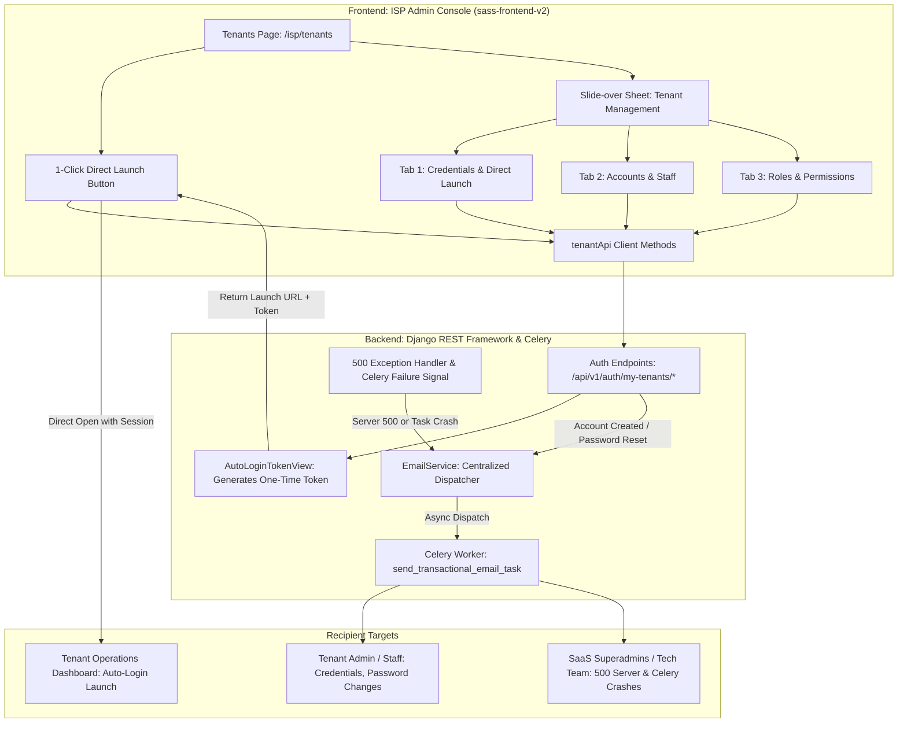

# Specification: ISP Admin Tenant Management with Direct Login & Universal Email Alerting

- **Date:** 2026-10-14
- **Status:** Approved
- **Scope:** Full-stack (Backend Django REST Framework + Celery, Frontend Next.js 15 App Router)

---

## 1. Executive Summary & Goals

This specification defines the complete end-to-end architecture and implementation for two core platform capabilities:
1. **Universal Email Alerting System**: Automatic email notifications covering the entire platform lifecycle—from user account creation, password changes, and tenant subscription updates, up to operational system failures (unhandled 500 server errors, Celery async task crashes, and network/MikroTik router connection drops).
2. **ISP Admin Tenant Management with 1-Click Direct Login**: An interactive administrative experience in the ISP Admin console (`app.localhost:8000` / `/isp/tenants`) allowing ISP owners to inspect credentials, reset tenant admin passwords, manage tenant staff accounts and granular roles, and directly launch the tenant dashboard via secure single-use auto-login tokens.

---

## 2. System Architecture & Components

---

## 3. Feature 1: Universal Email Alerting System

### 3.1. Email Event Classification & Recipients

| Event Category | Specific Trigger | Recipient | Subject Line Pattern | Template |
| :--- | :--- | :--- | :--- | :--- |
| **Account Creation** | Staff user created for tenant via `MyTenantAccountsView` or Platform admin creation | New User's email | `Your Access Credentials — {tenant_name}` | `user_credentials.html` |
| **Password Changed** | User password updated via `set-password`, `accounts/.../reset-password`, or `ChangePasswordView` | Affected User's email | `Security Alert: Your Password Was Changed — {platform_name}` | `password_changed_notification.html` |
| **Password Reset Link** | User requests forgot-password link | Requester's email | `Password Reset Request — {platform_name}` | `password_reset.html` |
| **Tenant Request Created** | ISP admin submits tenant purchase request | SaaS Superadmins (`settings.ADMINS`) | `New Tenant Request: {tenant_name} ({plan_name})` | `tenant_request_alert.html` |
| **Tenant Approved / Rejected** | SaaS admin approves or rejects tenant request | Tenant Contact Email | `Your Tenant Workspace is Ready! / Update on Request` | `tenant_request_status.html` |
| **System 500 Server Error** | DRF `standardized_exception_handler` catches 500 unhandled exception | Tech Team (`TECH_ALERT_EMAILS` or `ADMINS`) | `[CRITICAL ALERT] 500 Server Error: {path}` | `system_failure_alert.html` |
| **Celery Task Crash** | `@task_failure.connect` signal caught on background worker | Tech Team (`TECH_ALERT_EMAILS` or `ADMINS`) | `[WORKER FAILURE] Celery Task Failed: {task_name}` | `system_failure_alert.html` |
| **Network Router Drop** | MikroTik/NAS connection failure during sync/ping | Tenant Contact Email & Tech Team | `[NETWORK ALERT] Router Connection Lost: {router_name}` | `network_failure_alert.html` |

### 3.2. Email Service Methods (`apps/core/email/service.py`)

1. `send_system_failure_alert(error_type, error_message, traceback_str, path, tenant_slug=None, extra_context=None)`:
   - Renders `templates/emails/system_failure_alert.html` with highlighted callouts, server timestamp, stack trace, and request metadata.
   - Dispatches to `settings.ADMINS` or `settings.TECH_ALERT_EMAILS`.
2. `send_password_changed_notification(user, tenant=None, ip_address=None)`:
   - Notifies user of successful credential change, showing IP and security advisory.
3. `send_network_failure_alert(tenant, router_name, router_ip, error_details)`:
   - Notifies tenant operations that a hardware NAS / MikroTik device is unreachable.
4. `send_tenant_request_status_email(tenant_request, status, notes=None)`:
   - Notifies the requester when a tenant subscription request changes state.

### 3.3. Failure Capture Integrations

1. **DRF Exception Handler (`apps/core/exceptions.py`)**:
   - In `standardized_exception_handler`, check if status code is 500 (or unhandled `Exception`).
   - Extract traceback, endpoint URL, method, and user context.
   - Invoke `EmailService.send_system_failure_alert` asynchronously.
2. **Celery Task Failure Signal (`sheba_core/celery.py`)**:
   - Connect `@task_failure.connect` signal.
   - When a task fails, extract `task_id`, `args`, `kwargs`, and `exception`, then dispatch alert.

---

## 4. Feature 2: ISP Admin Dashboard Tenant Management & 1-Click Launch

### 4.1. Frontend API Layer (`sass-frontend-v2/src/lib/api/tenant.ts`)

Expose type-safe methods communicating with the verified backend endpoints:
- `getTenantCredentials(tenantId: string)`: `GET /api/v1/auth/my-tenants/{tenant_id}/credentials/`
- `setTenantPassword(tenantId: string, payload: { new_password: string; user_id?: number })`: `POST /api/v1/auth/my-tenants/{tenant_id}/set-password/`
- `getAutoLoginToken(tenantId: string)`: `POST /api/v1/auth/my-tenants/{tenant_id}/auto-login-token/`
- `getTenantAccounts(tenantId: string)`: `GET /api/v1/auth/my-tenants/{tenant_id}/accounts/`
- `createTenantAccount(tenantId: string, payload: { username: string; password: string; email?: string; first_name?: string; last_name?: string; phone?: string; role_id: string })`: `POST /api/v1/auth/my-tenants/{tenant_id}/accounts/`
- `resetAccountPassword(tenantId: string, userId: number, payload: { new_password: string })`: `POST /api/v1/auth/my-tenants/{tenant_id}/accounts/{userId}/reset-password/`
- `getTenantRoles(tenantId: string)`: `GET /api/v1/auth/my-tenants/{tenant_id}/roles/`
- `createTenantRole(tenantId: string, payload: { name: string; description?: string; permission_ids: string[] })`: `POST /api/v1/auth/my-tenants/{tenant_id}/roles/`
- `getTenantPermissions()`: `GET /api/v1/auth/my-tenants/permissions/`

### 4.2. UI Components & Layout (`sass-frontend-v2/src/app/isp/(dashboard)/tenants/page.tsx`)

#### 1. Tenant Table Actions Column
- **Direct Login Button**: Rocket/External icon. On click:
  - Dispatches `tenantApi.getAutoLoginToken(row.id)`.
  - Obtains `launch_url` with `auto_token`.
  - Instantly opens the URL in a new window/tab (`window.open(res.launch_url, '_blank')`).
  - Displays instant toast confirmation.
- **Manage Button**: Shield/Settings icon. Opens the Tenant Management Slide-Over Sheet.

#### 2. Tenant Management Slide-Over Sheet (`Sheet`)
- **Header**:
  - Tenant Name, Subdomain badge (`{slug}.shebafi.xyz` / `{slug}.localhost:3001`), Active status, and a prominent 1-click "Launch Workspace" button.
- **Tab 1: Credentials & Direct Access**:
  - Displays Administrator Username (`{slug}_admin`), Registered Contact Email, and Default Password Hint (`sheba1234`).
  - "Direct Login Link": Input field with copy-to-clipboard button.
  - "Change / Set Password" card:
    - Input for New Password with "Generate Strong Password" generator button.
    - Submit mutation calling `tenantApi.setTenantPassword()`.
- **Tab 2: Staff & Accounts**:
  - Table of active accounts in this tenant: Username, Full Name, Email, Assigned Role, Status badge.
  - "Add Staff Account" dialog:
    - Inputs: Username, Email, Temporary Password (with generator), Role selection dropdown.
    - Calling `createTenantAccount` automatically sends credentials email to the staff user.
  - Action per account: "Reset Password" dialog.
- **Tab 3: Roles & Permissions**:
  - Lists roles configured for the tenant (e.g. Admin, Billing Operator, Field Tech, Support).
  - Displays badge list of assigned permissions.
  - "Create Custom Role" button opening modal:
    - Role Name and Description.
    - Interactive permission checklist grouped by category (Subscribers, Billing, Network, Tickets, Audit).

---

## 5. Security & Isolation Guarantees

1. **Multi-Tenant Authorization Check**: Every backend endpoint executes `get_authorized_isp_tenant(request.user, tenant_id)`, verifying that the requesting user has an active `StaffMembership` with `role__name in ['Admin', 'Owner']` for the specified tenant or is a superuser. Unauthorized attempts return HTTP 403 Forbidden.
2. **One-Time Token Safety**: The `auto-login-token` endpoint returns an authenticated DRF Token. The tenant login page (`/tenant/login?auto_token=...`) securely persists it in browser storage and immediately redirects to `/tenant`, cleansing the URL so token keys don't linger in browser history.
3. **Password Policy Enforcement**: Password changes enforce Django's validators (minimum length, complexity, common password check).
4. **Resilient Email Dispatch**: Email delivery uses asynchronous Celery workers. If Celery or Redis is offline, it automatically falls back to synchronous direct send with fail-safe exception logging, ensuring business actions (like creating accounts or resetting passwords) never fail due to an email delivery timeout.

---

## 6. Verification & Test Plan

1. **Automated Backend Tests**:
   - `test_isp_tenant_accounts_roles.py`: 7 tests passing covering credentials lookup, set password, auto login token generation, account creation, account password reset, custom role creation, and forbidden access protection.
   - `test_email_service_notifications.py`: Add test suite verifying:
     - Account creation triggers `user_credentials` email.
     - Password change triggers security notification email.
     - 500 error handler catches unhandled exception and triggers `system_failure_alert` email.
     - Celery failure signal triggers alert email.
2. **Frontend Type Checking & Build**:
   - Execute TypeScript compiler check (`npm run type-check` or `npx tsc --noEmit`) to verify zero typing errors in `sass-frontend-v2`.
   - Verify React query invalidations, mutations, and sheet modals.
