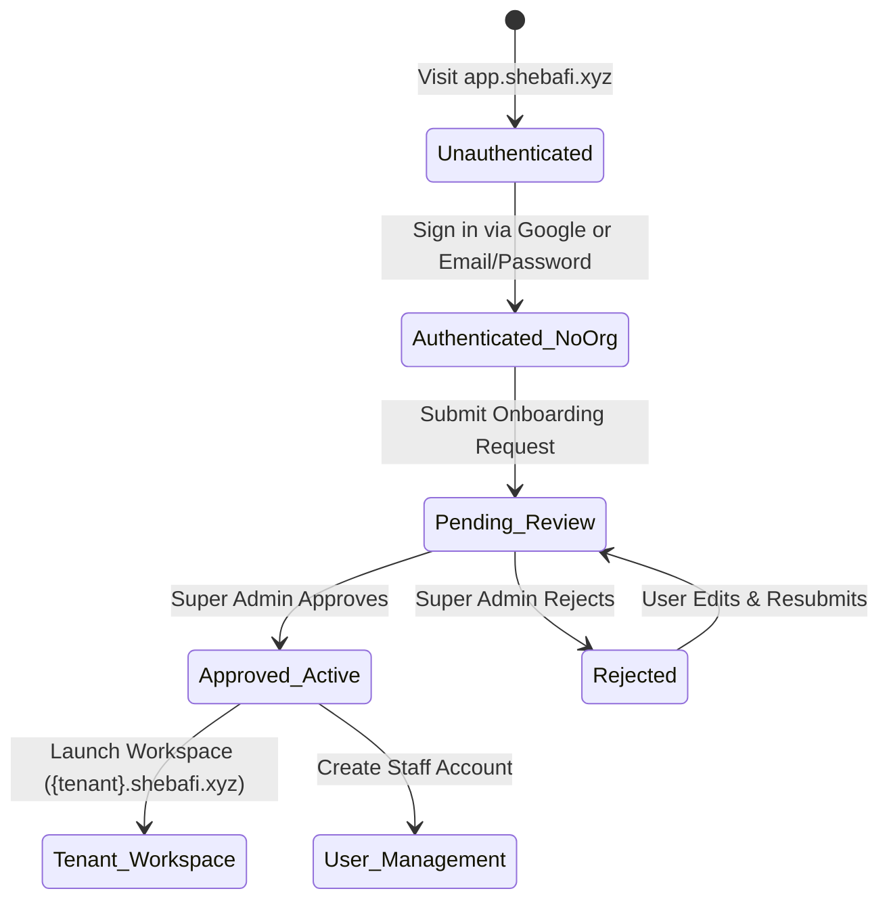

# External Neon PostgreSQL Database, Better Auth Integration & Organization Onboarding Lifecycle

**Document ID**: `SPEC-2026-10-25-NEON-BETTER-AUTH`  
**Date**: 2026-10-25  
**Status**: Approved  
**Target Systems**: `backend/` (Django 5 / DRF), `sass-frontend-v2/` (Next.js 16), Dokploy Production Stack  

---

## 1. Executive Summary

This specification establishes the architectural blueprint for transitioning Sheba ERP's production database to an external, serverless **Neon PostgreSQL** cluster and implementing a multi-portal authentication and onboarding model using **Better Auth**.

### Key Architectural Shifts
1. **Production Database**: Replace local Docker-managed Postgres in production with an external serverless **Neon PostgreSQL** database featuring SSL enforcement and connection pooling.
2. **Domain-Specific Authentication**:
   - `admin.shebafi.xyz`: Email/Username + Password authentication via Django Central Admin.
   - `app.shebafi.xyz`: Better Auth supporting **Google Direct Login** (OAuth 2.0) and **Email / Username & Password**.
   - `shebafi.xyz/signup` & `shebafi.xyz/onboarding`: Integrated with the Better Auth service with cross-subdomain cookie sharing (`.shebafi.xyz`).
   - `{tenant}.shebafi.xyz`: Username / Email + Password authentication for ISP staff and administrators.
3. **Onboarding Lifecycle**:
   - Authenticated users on `app.shebafi.xyz` who do not yet own an organization access an Onboarding Dashboard to submit a `TenantOnboardingRequest`.
   - Real-time status tracking (**Pending Review** &rarr; **Approved & Active** or **Rejected**).
   - Platform super-admins review and approve requests from `admin.shebafi.xyz`.
   - Upon approval, the organization owner manages their workspace from `app.shebafi.xyz` and manually provisions user accounts for `{tenant}.shebafi.xyz`.
   - All tenant operations remain backwards-compatible and identical to existing workflows.

---

## 2. Multi-Portal Topology & Routing Matrix

| Hostname | Portal Role | Auth Mechanism | Primary Experience |
| :--- | :--- | :--- | :--- |
| **`admin.shebafi.xyz`** | Super Admin SaaS Control Plane | Django Central Admin Session (`/api/v1/saas/auth/`) | Platform telemetry, tenant approval queue, packages, billing reconcile |
| **`shebafi.xyz`** | Public Marketing & Sign-up | Better Auth (`/api/auth/*`) | Landing pages, pricing, direct sign-up (`/signup`), onboarding wizard (`/onboarding`) |
| **`app.shebafi.xyz`** | Client Organization Dashboard | Better Auth (`/api/auth/*`) | User profile, onboarding request status tracker, tenant user provisioning |
| **`{tenant}.shebafi.xyz`** | Dedicated ISP Tenant Workspace | Django Tenant Auth (`/api/v1/auth/login/`) | Daily ISP operations (Customers, Billing, OLT/MikroTik, Inventory, Support) |

---

## 3. External Neon PostgreSQL Database Architecture

### 3.1. Database Connection Topology
Both the Django backend API and the Next.js frontend (Better Auth) connect to the same external Neon PostgreSQL cluster.

```
       ┌───────────────────────────────┐
       │     Neon PostgreSQL Cluster   │
       │  (ep-...-pooler.neon.tech)    │
       └──────────────┬────────────────┘
                      │
         ┌────────────┴────────────┐
         │ (SSL Required / Pooler) │
         ▼                         ▼
┌──────────────────┐      ┌──────────────────┐
│  Django Backend  │      │ Next.js Frontend │
│   (Gunicorn/DRF) │      │  (Better Auth)   │
└──────────────────┘      └──────────────────┘
```

1. **Transactional Database URL (`DATABASE_URL`)**:
   - Points to Neon's PgBouncer pooler endpoint:
     `postgresql://<user>:<password>@ep-...-pooler.ap-southeast-1.aws.neon.tech/sheba_erp?sslmode=require`
2. **Direct Database URL (`DIRECT_DATABASE_URL`)**:
   - Used for Django migrations (`manage.py migrate`) and Better Auth migrations to bypass PgBouncer statement-level limits:
     `postgresql://<user>:<password>@ep-....ap-southeast-1.aws.neon.tech/sheba_erp?sslmode=require`

### 3.2. Django Production Configuration (`backend/sheba_core/settings.py`)
```python
# Database Configuration supporting Neon Postgres
DATABASES = {
    'default': env.db('DATABASE_URL', default=f"sqlite:///{BASE_DIR / 'db.sqlite3'}")
}

if not DEBUG and 'sqlite' not in DATABASES['default']['ENGINE']:
    DATABASES['default'].setdefault('OPTIONS', {})
    DATABASES['default']['OPTIONS']['sslmode'] = 'require'
    DATABASES['default']['CONN_MAX_AGE'] = env.int('DB_CONN_MAX_AGE', 300)
```

### 3.3. Dokploy Compose Stack (`docker-compose.dokploy.yml`)
- Update `docker-compose.dokploy.yml` to remove strict dependency on local `postgres` service when external `DATABASE_URL` is set.
- Add documentation in `DEPLOYMENT_DOKPLOY_VERCEL.md` and `.env.production.example` for Neon PostgreSQL setup.

---

## 4. Better Auth Implementation (`sass-frontend-v2`)

### 4.1. Configuration (`src/lib/auth.ts`)
Better Auth runs within Next.js, connected to Neon PostgreSQL.

* **Dependencies**: `better-auth`, `@neondatabase/serverless` (or `pg`).
* **Plugins**:
  - `username()` plugin: Enables registration and authentication using either username or email.
* **Providers**:
  1. **Google OAuth 2.0**:
     - Client ID: `GOOGLE_CLIENT_ID`
     - Client Secret: `GOOGLE_CLIENT_SECRET`
  2. **Credential Auth**:
     - Email / Username + Password
     - Secure password hashing managed by Better Auth.
* **Session Cookie Configuration**:
  - `cookieName`: `sheba_auth_session`
  - `domain`: `.shebafi.xyz` (in production) to permit session sharing between `shebafi.xyz` and `app.shebafi.xyz`.
  - `sameSite`: `lax`
  - `secure`: `true` (enforced via HTTPS).

### 4.2. Better Auth Database Tables (Neon Postgres)
Better Auth automatically creates and maintains the following tables in the Neon PostgreSQL database:
- `user`: `id`, `name`, `email`, `emailVerified`, `image`, `createdAt`, `updatedAt`, `username`
- `session`: `id`, `userId`, `token`, `expiresAt`, `ipAddress`, `userAgent`
- `account`: `id`, `userId`, `accountId`, `providerId`, `accessToken`, `refreshToken`, `password`
- `verification`: `id`, `identifier`, `value`, `expiresAt`

---

## 5. User Interface & Multi-Page Auth Flows

### 5.1. Authentication Screens (`/login` & `/signup`)
Implemented on both `shebafi.xyz` and `app.shebafi.xyz`:
1. **Google Direct Login**:
   - Prominent Google button with official Google branding.
   - One-click authorization redirecting back to `app.shebafi.xyz/dashboard`.
2. **Email / Username & Password**:
   - Single input accepting either username or email for sign-in.
   - Separate Full Name, Username, Email, and Password inputs for sign-up.
   - Client-side validation for username format (alphanumeric, lowercase, dashes).

### 5.2. Public Onboarding Integration (`https://shebafi.xyz/onboarding`)
- **Step 1 (Identity)**:
  - If user is already authenticated via Better Auth: displays "Logged in as [Name] ([email])" with a toggle to switch accounts.
  - If unauthenticated: displays the Google Direct Login or Email/Username & Password form inline.
- **Step 2 (Organization Details)**:
  - Organization Name, Desired Slug, Contact Phone, Business Address.
- **Step 3 (Package & Tier)**:
  - Selection of ISP SaaS packages loaded dynamically from `/api/v1/public/packages/`.
- **Step 4 (Submission)**:
  - Submits onboarding request linked to the Better Auth user account.
  - Immediately redirects to `app.shebafi.xyz/dashboard`.

---

## 6. Client Organization Onboarding Lifecycle (`app.shebafi.xyz`)

### 6.1. State Machine


### 6.2. Dashboard State Details
1. **State: No Organization Request**:
   - Welcome banner explaining the platform.
   - Interactive organization request form with real-time slug availability check.
2. **State: Pending Review**:
   - Prominent status card: `Pending Review` (Amber badge).
   - Display of submitted parameters: Organization Name, Requested Subdomain (`{slug}.shebafi.xyz`), Plan, and Submission Timestamp.
   - Live polling / re-validation every 30 seconds for status change.
3. **State: Rejected**:
   - Red status badge + rejection reason provided by Super Admin.
   - Action to modify details and re-request review.
4. **State: Approved & Active**:
   - Transition to full Organization Dashboard:
     - **Launch Workspace**: Deep-link to `https://{tenant-slug}.shebafi.xyz`.
     - **Subscription Overview**: Current plan tier, renewal date, quota metrics.
     - **Tenant User Management**: Panel for provisioning staff credentials.

---

## 7. Super Admin Approval Pipeline (`admin.shebafi.xyz`)

1. Platform Admin logs into `admin.shebafi.xyz` using Django central credentials.
2. Navigates to `/saas/onboarding` (SaaS Control Plane).
3. The queue displays all incoming `TenantOnboardingRequest` items, displaying:
   - Organization Name & Slug
   - Contact Person & Better Auth User Email
   - Desired Plan
   - Submission Date
4. **Approval Action**:
   - Admin clicks **"Approve & Deploy"**.
   - Django executes atomic transaction:
     - Creates `core_organization` record.
     - Creates `core_tenant` record with slug and assigned database binding.
     - Creates `core_organizationmembership` linking user as `OWNER`.
     - Assigns subscription package and creates active `TenantSubscription`.
     - Updates `TenantOnboardingRequest.status = 'approved'`.
5. The user's session on `app.shebafi.xyz` reflects the approval immediately.

---

## 8. Tenant User Management & Operations (`{tenant}.shebafi.xyz`)

### 8.1. Provisioning Accounts from `app.shebafi.xyz`
* Organization owners create staff accounts from the **"Tenant Users"** tab on `app.shebafi.xyz`.
* **Form Inputs**:
  - Full Name
  - Username
  - Email
  - Password & Confirm Password
  - Role: ISP Admin, Billing Manager, Support Staff, Network Technician.
* **Backend Endpoint**:
  `POST /api/v1/saas/organizations/{org_id}/tenants/{tenant_id}/users/`
  - Validates caller is the verified Organization Owner.
  - Provisions Django `User` in `auth_user` with hashed password.
  - Creates `StaffProfile` and assigns `UserRole`.

### 8.2. Logging In to `{tenant}.shebafi.xyz`
* Users navigate to `https://{tenant-slug}.shebafi.xyz/login`.
* Form inputs: **Username or Email** and **Password**.
* Backend authenticates against Django DRF (`POST /api/v1/auth/login/`), scoping the lookup to the active tenant domain.
* Generates tenant session token (`Token` or session cookie).
* **Operational Guarantees**:
  - All existing tenant capabilities (MikroTik sync, PPPoE/Static users, OLT optical power monitoring, bKash automated billing, billing zones) remain 100% unchanged.

---

## 9. Security & Multi-Tenant Isolation

1. **Subdomain Strict Scoping**:
   - Django middleware enforces tenant scoping via `X-Tenant-ID` and hostname resolution.
   - Credentials provisioned for Tenant A cannot authenticate on Tenant B.
2. **Session Cookie Isolation**:
   - Better Auth cookies are restricted to `.shebafi.xyz` and `app.shebafi.xyz`.
   - Tenant tokens for `{tenant}.shebafi.xyz` remain localized to their specific origin.
3. **SSL Mode Enforcement**:
   - All database communication to Neon PostgreSQL requires `sslmode=require`.
4. **Idempotency & Collision Prevention**:
   - Slugs and usernames validated against both Better Auth tables and Django tables to prevent collisions across services.

---

## 10. Implementation Plan & Verification Strategy

### Phase 1: Neon Database Configuration & Production Support
- Update `backend/sheba_core/settings.py` for Neon SSL and connection pooling.
- Update `docker-compose.dokploy.yml` and `.env.production.example` to allow bypassing local postgres container.
- Validate Django migrations run cleanly against Neon Postgres.

### Phase 2: Better Auth Integration (`sass-frontend-v2`)
- Install Better Auth dependencies and configure `src/lib/auth.ts` with Neon connection.
- Enable Google OAuth provider and Username plugin.
- Mount API handler at `src/app/api/auth/[...all]/route.ts`.
- Set up cookie domain configuration for apex and subdomain sharing.

### Phase 3: Auth Pages & Onboarding Wizard Integration
- Update `/login` and `/signup` on `shebafi.xyz` and `app.shebafi.xyz` with Google Direct Login + Username/Email & Password.
- Update `https://shebafi.xyz/onboarding` to integrate with Better Auth session.

### Phase 4: User Onboarding Dashboard (`app.shebafi.xyz`)
- Build the Onboarding Dashboard with 4 distinct visual states (No Request, Pending Review, Rejected, Approved).
- Connect request submission to Django `TenantOnboardingRequest` API.

### Phase 5: Tenant User Provisioning & Approval Linking
- Implement owner-facing Tenant User Creation UI on `app.shebafi.xyz`.
- Connect to Django staff provisioning API for the tenant.
- End-to-end verification: Signup &rarr; Request &rarr; Super Admin Approve &rarr; Create Tenant User &rarr; Login on `{tenant}.shebafi.xyz`.
